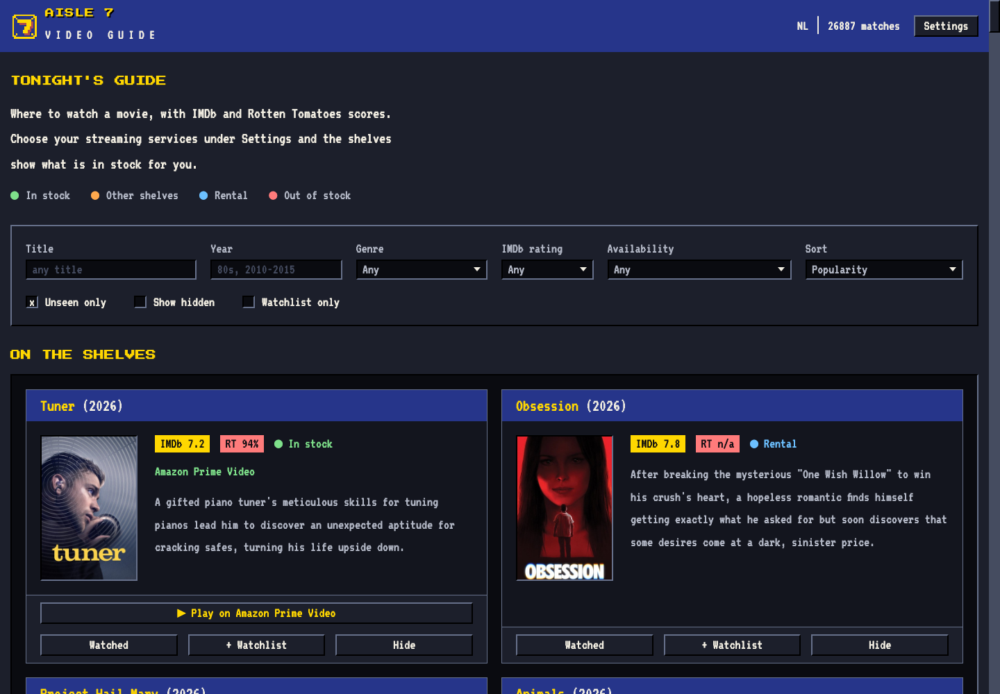
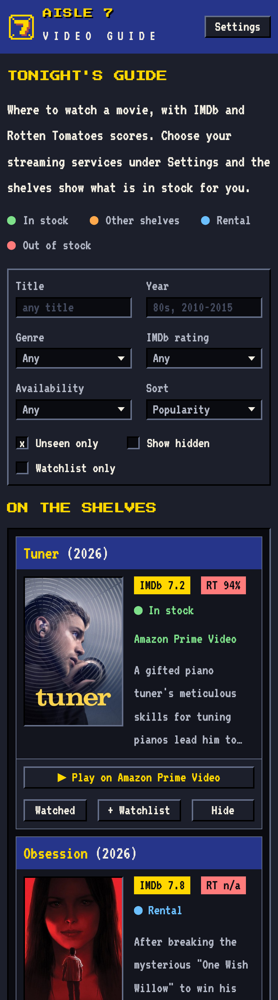

# Aisle 7

A video-rental guide: where to watch a movie, with IMDb and Rotten Tomatoes scores.
Pick your country and streaming services once, and the shelves show what is in stock
for you, what is on someone else's shelf, and what you can rent.

It runs in the terminal or as a web app for your network.





## Run it

```sh
./install.sh        # builds the web app (needs npm) and installs `aisle7` to ~/.local/bin
aisle7              # the terminal app (at least 110 columns wide for cover images)
aisle7 serve        # the web app on http://localhost:8080
```

`aisle7 -h` lists the search options and keys. Watched, hidden and watchlist titles
are shared between the terminal app and the web app.

## Docker

```sh
docker build -t aisle7 .
docker run -p 8080:8080 -v ~/Library/Application\ Support/aisle7:/data/aisle7 aisle7
```

## Watchlist alerts

`aisle7 serve -webhook <url>` checks your watchlist every hour (`-every 1h`) and posts
to the webhook when a title starts streaming on one of your services. Each title is
announced once. It works with a Home Assistant webhook trigger.

## Notes

- Data comes from JustWatch's unofficial GraphQL API, which can change without notice.
- The web app has no login. Keep it on your own network.
- Go with Gin for the API, React, Vite and Tailwind CSS for the web app.
